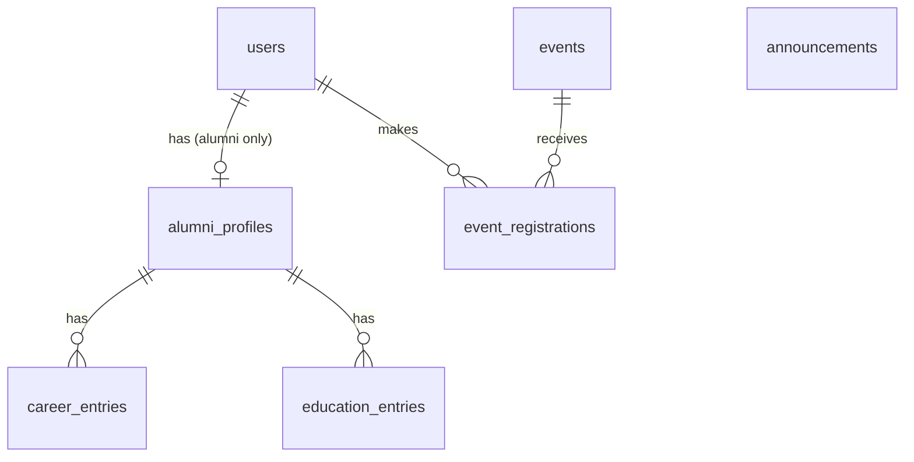

# Data Design Document (DDD)

How ATS stores its data: entities, tables, columns, constraints and the rules around them.
This is the design the Prisma schema (week 5) will implement; when the schema changes, this file changes in the same commit.

| | |
|---|---|
| **Database** | PostgreSQL 18 (Docker service `db`) |
| **Storage** | Docker volume `alumni-db-data`: kept by `docker compose down`, deleted by `docker compose down -v` |
| **Access** | Prisma 7: schema in `backend/prisma/schema.prisma`, migrations in `backend/prisma/migrations/`. The models in `backend/src/*/*.model.ts` still keep data in memory until week 6 |
| **Demo data** | `backend/prisma/seed.ts` builds records with the factories in `backend/prisma/factories.ts`: synthetic Turkish names (fakerTR), e-mails at `example.com` |
| **Status** | All tables below exist in the database (first migration). Two are used by the code (`users`, `announcements`); the rest wait for week 7 and may still change |

## 1. Conventions

| Topic | Decision |
|---|---|
| Table names | plural `snake_case` (`users`, `career_entries`) |
| Primary key | `id`, integer, generated by the database |
| Timestamps | `created_at` (and `updated_at` where a row is edited), type `timestamptz`; the API returns them as ISO strings |
| Enums | fixed lists kept in one place (section 5); a value outside the list is a `400` |
| E-mail | stored lower-case, unique |
| Foreign keys | named `<entity>_id`; what happens on delete is stated per relation |
| Personal data | only what the feature needs (see section 7) |

## 2. Entities

| Entity | Table | Purpose | Status |
|---|---|---|---|
| User | `users` | An account: who can sign in, with which role | in code (memory) |
| Announcement | `announcements` | News posted for everyone | in code (memory) |
| Alumni profile | `alumni_profiles` | Name, graduation year and city of a graduate | planned, week 7 |
| Career entry | `career_entries` | One job a graduate has held | planned, week 7 |
| Education entry | `education_entries` | One degree a graduate has earned | planned, week 7 |
| Event | `events` | A meetup or talk organised by staff | planned, week 7 |
| Event registration | `event_registrations` | Which user registered for which event | planned, week 7 |

## 3. Relationships

`announcements` stands alone for now: it has no author column until accounts exist (week 11).

## 4. Tables

`PK` primary key · `FK` foreign key · `UQ` unique · `NN` not null

### 4.1 `users` *(in code)*

| Column | Type | Constraints | Notes |
|---|---|---|---|
| `id` | integer | PK | |
| `email` | varchar | UQ, NN | lower-case; duplicate → `409` |
| `role` | enum `Role` | NN | `ADMIN`, `STAFF`, `ALUMNI`, `STUDENT` |
| `status` | enum `Status` | NN, default `PENDING` | a new user always starts as `PENDING` |
| `created_at` | timestamptz | NN, default now | |

No password column yet: authentication arrives in week 11.

### 4.2 `announcements` *(in code)*

| Column | Type | Constraints | Notes |
|---|---|---|---|
| `id` | integer | PK | |
| `title` | varchar(120) | NN | trimmed, 1–120 characters |
| `content` | varchar(2000) | NN | trimmed, 1–2000 characters |
| `created_at` | timestamptz | NN, default now | |
| `updated_at` | timestamptz | NN | set on every edit |

The list is shown newest first.

### 4.3 `alumni_profiles` *(planned)*

| Column | Type | Constraints | Notes |
|---|---|---|---|
| `id` | integer | PK | |
| `user_id` | integer | FK → `users.id`, UQ, NN | one profile per user; delete the user → delete the profile |
| `full_name` | varchar | NN | |
| `graduation_year` | integer | NN | |
| `city` | varchar | | city level only, no street address |

### 4.4 `career_entries` *(planned)*

| Column | Type | Constraints | Notes |
|---|---|---|---|
| `id` | integer | PK | |
| `alumni_profile_id` | integer | FK → `alumni_profiles.id`, NN | delete the profile → delete its entries |
| `company` | varchar | NN | |
| `position` | varchar | NN | |
| `start_date` | date | NN | |
| `end_date` | date | | empty = current job; must not be before `start_date` |

### 4.5 `education_entries` *(planned)*

| Column | Type | Constraints | Notes |
|---|---|---|---|
| `id` | integer | PK | |
| `alumni_profile_id` | integer | FK → `alumni_profiles.id`, NN | delete the profile → delete its entries |
| `institution` | varchar | NN | |
| `degree` | varchar | NN | |
| `graduation_year` | integer | NN | |

### 4.6 `events` *(planned)*

| Column | Type | Constraints | Notes |
|---|---|---|---|
| `id` | integer | PK | |
| `title` | varchar | NN | |
| `description` | text | | |
| `starts_at` | timestamptz | NN | |
| `location` | varchar | | |
| `capacity` | integer | | empty = no limit |

### 4.7 `event_registrations` *(planned)*

| Column | Type | Constraints | Notes |
|---|---|---|---|
| `id` | integer | PK | |
| `event_id` | integer | FK → `events.id`, NN | delete the event → delete its registrations |
| `user_id` | integer | FK → `users.id`, NN | delete the user → delete their registrations |
| `created_at` | timestamptz | NN, default now | |
| | | UQ (`event_id`, `user_id`) | a user registers once per event; duplicate → `409` |

## 5. Enums

| Enum | Values |
|---|---|
| `Role` | `ADMIN`, `STAFF`, `ALUMNI`, `STUDENT` |
| `Status` | `PENDING`, `ACTIVE`, `REJECTED`, `SUSPENDED` |

## 6. Where each rule lives

| Rule | Enforced by |
|---|---|
| Required fields, length limits, enum values | service (`400`) |
| Missing record | service (`404`), the model only returns `undefined` or `false` |
| Duplicate e-mail / duplicate registration | service checks first (`409`); a database `UNIQUE` constraint is the safety net |
| Row references that must exist | database foreign keys |

## 7. Privacy (KVKK)

Not stored, by design: national ID number, birth date, grades, home address.
Location is city level. Demo and seed data are synthetic.

## 8. Open points

- Whether an alumnus can hold more than one profile or a user can hold two roles (now: one role, one profile).
- Which profile fields get per-field visibility (README section 7) and how that is stored: planned for week 11, not designed yet.
