<div align="center">

# 🎓 Alumni Tracking System (ATS)

**A web system that helps a university stay in touch with its graduates:**
who they are, where they work, and how they can help the students who come after them.


[Quick start](#2-quick-start) · [Architecture](#4-how-the-code-is-organised) · [Data model](#5-data-model) · [Roadmap](#6-roadmap) · [DDD.md](DDD.md) · [TODO.md](TODO.md)

</div>

---

> [!NOTE]
> **Web Programming (YBSB3001)** · Istanbul University, Faculty of Economics, MIS · Fall 2026<br/>
> **Author:** [@gulnihalarikaymak](https://github.com/gulnihalarikaymak)<br/>
> **Status:** Users, announcements, job postings and job applications: CRUD as web pages and a JSON API, in MVC, stored in PostgreSQL through Prisma.

## Contents

1. [What the system is](#1-what-the-system-is)
2. [Quick start](#2-quick-start)
3. [Stack and why](#3-stack-and-why)
4. [How the code is organised](#4-how-the-code-is-organised)
5. [Data model](#5-data-model)
6. [Roadmap](#6-roadmap)
7. [Working with an AI assistant](#7-working-with-an-ai-assistant)
8. [Security and privacy](#8-security-and-privacy)
9. [Conventions](#9-conventions)
10. [Limitations](#10-limitations)
11. [Credits and license](#11-credits-and-license)

---

## 1. What the system is

Universities lose sight of their students at graduation: contact details go stale, career outcomes live in spreadsheets, and students who would gain from an alumnus's advice never meet one. ATS is one place for all of that.

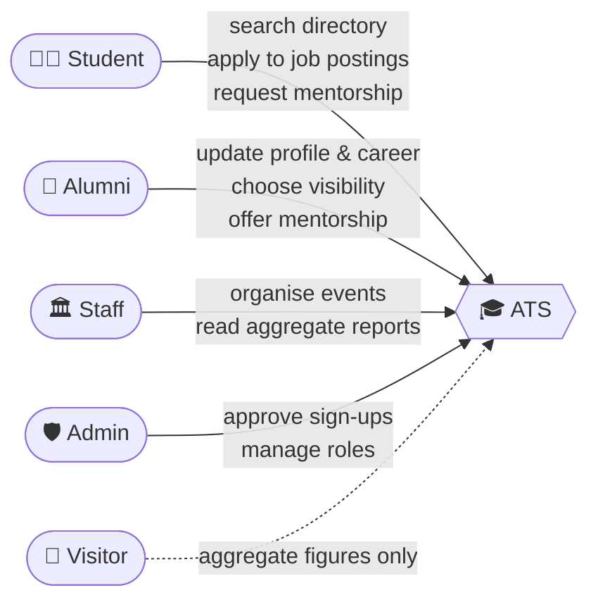

| Role | What they can do *(planned)* |
|---|---|
| 🧑‍🎓 **Student** | Search the alumni directory, apply to job postings, request mentorship, register for events |
| 👔 **Alumni** | Keep profile and career history current, choose who sees what, apply to job postings, offer mentorship |
| 🏛️ **Staff** | Organise events, read aggregate reports on where graduates work |
| 🛡️ **Admin** | Approve sign-ups, manage accounts and roles |

> [!IMPORTANT]
> Visitors who are not signed in see only aggregate figures, never an individual's profile.

### Scope

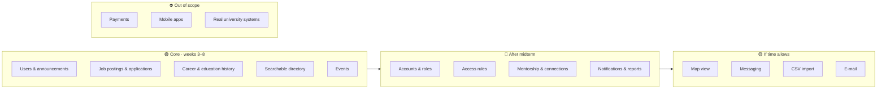

Job postings and applications were added to the core in class (week 6).

---

## 2. Quick start

> [!TIP]
> **Requirements:** Git and Docker with Compose v2. Nothing else: no local Node.js, PostgreSQL or `.env` file needed.

```bash
git clone https://github.com/gulnihalarikaymak/alumni.git
cd alumni
docker compose up
```

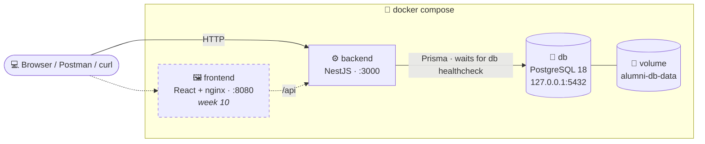

| Address | What it is |
|---|---|
| `http://localhost:3000/users` | 📄 Web pages for users |
| `http://localhost:3000/announcements` | 📄 Web pages for announcements |
| `http://localhost:3000/job-postings` | 📄 Web pages for job postings, and each posting's applications |
| `http://localhost:3000/job-applications` | 📄 Web pages for all job applications |
| `http://localhost:3000/api/...` | 🔌 JSON API for the same data (`users`, `announcements`, `job-postings`, `job-applications`) |
| `http://localhost:3000/api/swagger` | 📘 Interactive API docs |
| `http://localhost:3000/api/health` | 💚 Health check (JSON for curl, a status page in a browser) |

Only `db` and `backend` run so far; the React front end joins in week 10 on port `8080`. A Postman collection with error cases is in `postman/`.

<details>
<summary><b>🛠️ Everyday commands</b> (click to expand)</summary>

| Task | Command |
|---|---|
| Rebuild after code changes | `docker compose up --build` |
| Follow the API logs | `docker compose logs -f backend` |
| Stop, keep the data | `docker compose down` |
| Stop and **delete the database** (volume `alumni-db-data`) | `docker compose down -v` |
| Create a migration after editing `schema.prisma` | `cd backend` then `npx prisma migrate dev --name <change>` (with `db` running) |
| See which migrations are applied | `docker compose exec backend npx prisma migrate status` |
| Add **more** synthetic demo data | `cd backend` then `npx prisma db seed` (dev host with Node.js and `db` running; adds, never deletes) |

Migrations in `backend/prisma/migrations/` are applied automatically when the backend container starts. An **empty** database is then filled with synthetic demo data automatically on first start, so `docker compose up` on a fresh volume already has something to show. It is idempotent (once there is at least one user it does nothing), and `AUTO_SEED=false` turns it off.

Settings (database name, user, password, ports) have defaults in `docker-compose.yml`. To change one, copy `.env.example` to `.env`. If a port is taken, set `DB_PORT` or `BACKEND_PORT` there.

</details>

> [!WARNING]
> `docker compose down -v` deletes the database volume. Use `docker compose down` to keep your data.

---

## 3. Stack and why

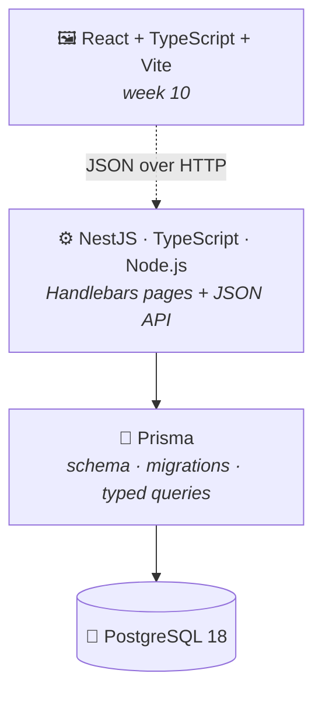

| Layer | Choice | ✅ Why | ⚠️ Weakness |
|---|---|---|---|
| Back end | TypeScript, Node.js, NestJS | One language with the front end. NestJS gives each weekly topic its own building block: controllers, services, middleware, guards, pipes | CPU-heavy work blocks the single thread unless moved to a worker |
| Database | PostgreSQL 18 | The data is relational: people, degrees, careers, events, applications. Foreign keys, constraints and transactions do real work | Scaling writes across servers is hard; needs routine backups and maintenance |
| Data access | Prisma | Readable schema, migrations as files in git, type-safe queries | Weak support for geospatial types |
| Front end | React, TypeScript, Vite *(week 10)* | A UI was already designed in the Web Design course (Figma → React) | A single-page app is worse for search engines; irrelevant for a signed-in app |
| Packaging | Docker Compose | Required by the course; same environment for everyone | Slow first build, memory-hungry on Windows/macOS |

<details>
<summary><b>Alternatives considered</b></summary>

| Option | Why not |
|---|---|
| ASP.NET Core | A second language to defend |
| Django | Its admin would do the work I am supposed to build |
| Express | Too unstructured |
| MySQL | Weaker constraints |
| MongoDB | The data is relational |

</details>

---

## 4. How the code is organised

### MVC in NestJS

The rule: **controller → service → model**, never the other way. Every feature folder (`users/`, `announcements/`, `job-postings/`, `job-applications/`) follows it; `users/` is shown here.

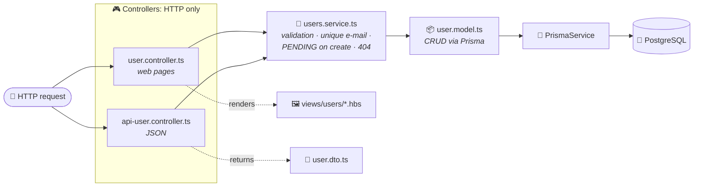

| Layer | Job | File in `backend/src/users/` |
|---|---|---|
| **Model** | The `User` type and CRUD on the `users` table through Prisma: `create`, `findAll`, `findById`, `findByEmail`, `update`, `delete` | `user.model.ts` |
| **Service** | Business rules: validation, unique e-mail, new users start as `PENDING`, missing record → `404` | `users.service.ts` |
| **Controller** | HTTP only: route, verb, status code. One line per method, calling the service | `user.controller.ts` (pages), `api-user.controller.ts` (JSON) |
| **View** | Handlebars templates for the pages, DTO shapes for the JSON | `backend/views/users/*.hbs`, `user.dto.ts` |

Both controllers share one `UsersService`, so a user created through the API shows up on the web pages immediately, and the rules are written once. When the in-memory array was replaced by PostgreSQL (week 5), the models changed and the service and controllers only learned to wait (`async`/`await`) for them.

### A request, step by step

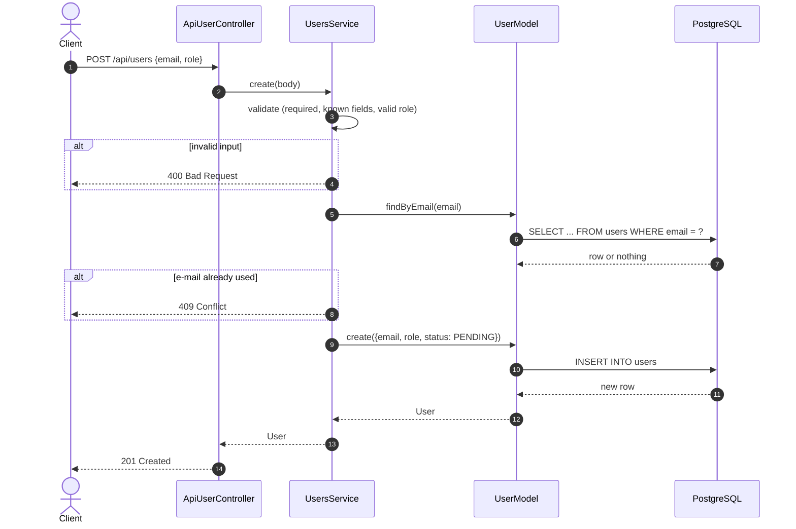

### Routes

All URL prefixes live in one file, `backend/src/app.routes.ts`. Users, announcements and job postings share the same CRUD shape:

| CRUD | 📄 Web page (`/users`) | 🔌 JSON API (`/api/users`) |
|---|---|---|
| List | `GET /users` | `GET /api/users` → `200` |
| Create | `GET /users/create` (form), `POST /users` | `POST /api/users` → `201` |
| Read one | `GET /users/:id` | `GET /api/users/:id` → `200` |
| Replace | `GET /users/:id/edit` (form), `PUT /users/:id` | `PUT /api/users/:id` → `200` |
| Update some fields | `PATCH /users/:id` | `PATCH /api/users/:id` → `200` |
| Delete | `DELETE /users/:id` | `DELETE /api/users/:id` → `204` |

**Errors:** invalid input or non-numeric id → `400` · e-mail already used → `409` · unknown id → `404`. Pages show the form again with the messages; the API returns JSON.

### Job postings and applications

Job postings belong to no user and have **direct** routes only. Users reach postings through job applications, which have two parents and are nested under both:

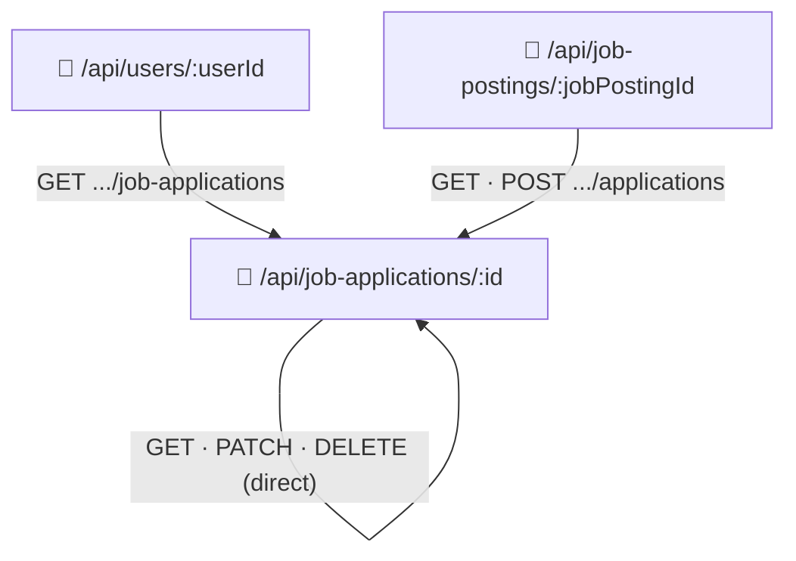

| Direct (`/api/job-applications`) | Nested |
|---|---|
| `GET /api/job-applications`, `GET /api/job-applications/:id` → `200` | `GET /api/job-postings/:jobPostingId/applications` → `200` |
| `PATCH /api/job-applications/:id` (status, cover letter) → `200`; `DELETE` → `204` | `POST /api/job-postings/:jobPostingId/applications` → `201` |
| | `GET /api/users/:userId/job-applications` → `200` |

Applying (`POST`, body `{applicantId, coverLetter?}`) checks these rules in order:

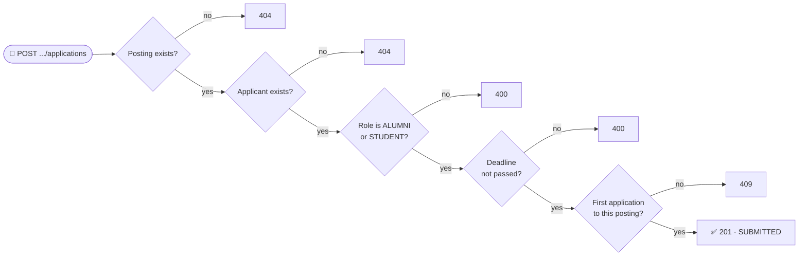

Pages: `/job-postings` (list, create, show, edit, delete), `/job-postings/:jobPostingId/applications` (one posting's applications and the apply form), `/job-applications` (all), `/job-applications/:id` (change the status or withdraw).

### Method override for HTML forms

HTML forms can only send `GET` and `POST`, so they post with `?_method=PUT|PATCH|DELETE`, and `src/common/method-override.ts` rewrites the method before routing:

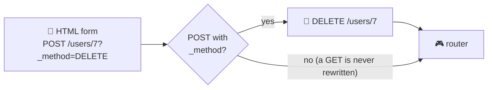

### Folders

```
alumni/
├── docker-compose.yml          db + backend
├── .env.example                optional overrides
├── DDD.md                      data design: entities, tables, constraints
├── TODO.md                     tasks given in class, week by week
├── backend/
│   ├── prisma/                 schema.prisma, migrations/, seed.ts (manual demo-data command)
│   ├── prisma.config.ts        Prisma settings: schema path and database URL
│   ├── views/                  Handlebars: layout, partials/, one folder per feature
│   └── src/
│       ├── main.ts             bootstrap: views, method override, Swagger, port
│       ├── app.routes.ts       route map
│       ├── common/             shared helpers (views setup, method override)
│       ├── prisma/             PrismaService: the one database connection the models share
│       ├── database/           startup seed: demo data on first run (empty DB), factories
│       ├── users/              ┐
│       ├── announcements/      │ one folder per feature:
│       ├── job-postings/       │ model, service, controllers, modules
│       ├── job-applications/   ┘
│       └── health/             GET /api/health
├── frontend/                   React app (week 10)
└── postman/                    request collection, including error cases
```

### Known gaps

- [ ] Validation is hand-written in each service; `class-validator` DTOs will replace it.
- [ ] Database errors other than "not found" (for example two requests taking the same e-mail at the same moment) still end as `500`; one error format comes with the middleware in week 9.
- [ ] The Postman collection covers users and health only, not announcements, job postings or applications yet.
- [ ] `AppController` still holds the week 2 demo routes (`/hello`, `/sum/...`) with inline HTML; removed in week 10.

---

## 5. Data model

All nine tables exist in the database (created by the migrations). Four are used by the code; the rest wait for week 7. Columns, enums and delete rules are in **[DDD.md](DDD.md)**.

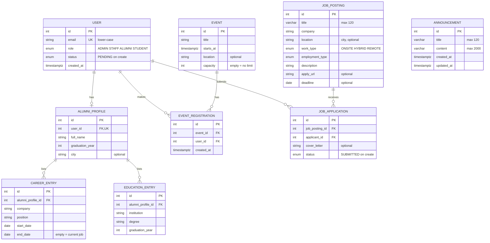

| | In code | Waiting for week 7 |
|---|---|---|
| Tables | `users`, `announcements`, `job_postings`, `job_applications` | `alumni_profiles`, `career_entries`, `education_entries`, `events`, `event_registrations` |

> [!NOTE]
> Unique pairs: a user applies **once per posting** (`job_posting_id`, `applicant_id`) and registers **once per event** (`event_id`, `user_id`). Deleting a parent row deletes its children (`ON DELETE CASCADE`).

---

## 6. Roadmap

```mermaid
flowchart LR
    W1["01<br/>Inception"]:::done --> W2["02<br/>Routing"]:::done --> W3["03<br/>CRUD"]:::done --> W4["04<br/>MVC"]:::done --> W5["05<br/>ORM"]:::done --> W6["06<br/>DB integration"]:::done --> W7["07<br/>Relations"]:::todo
    W7 --> W8["08<br/>⭐ MIDTERM"]:::exam --> W9["09<br/>Middleware"]:::todo --> W10["10<br/>Front end"]:::todo --> W11["11<br/>Auth"]:::todo --> W12["12<br/>Services"]:::todo --> W13["13<br/>CI/CD"]:::todo --> W14["14<br/>⭐ FINAL"]:::exam

    classDef done fill:#2da44e,color:#fff,stroke:#1a7f37
    classDef todo fill:#f6f8fa,color:#57606a,stroke:#d0d7de
    classDef exam fill:#bf8700,color:#fff,stroke:#9a6700
```

| Week | Topic | What ATS gets | Status |
|:---:|---|---|:---:|
| 01 | Project inception | Public repo, README, stack decisions | ✅ |
| 02 | Routing | NestJS project, demo and health routes, `docker compose up` | ✅ |
| 03 | HTTP methods and CRUD | Users CRUD with correct verbs, status codes and validation; Swagger; Postman | ✅ |
| 04 | MVC | Model, service and controller split; web pages and JSON API share one service | ✅ |
| 05 | Database and ORM | `DDD.md`, Prisma schema and first migration, persistent volume, seed data; users and announcements on PostgreSQL | ✅ |
| 06 | Database integration | Job postings and job applications: migrations, models, direct and nested routes, seed | ✅ |
| 07 | Relational data | Career and education history, event registrations, directory search and pagination | 🗓️ |
| 08 | **Midterm** | Core features running on PostgreSQL, documented and tested | 🗓️ |
| 09 | Middleware | Logging, request ids, security headers, rate limiting, one error format | 🗓️ |
| 10 | Front end | React app served by nginx; full stack from one command | 🗓️ |
| 11 | Auth | Sign-up with approval, sessions, role and ownership checks | 🗓️ |
| 12 | Service layers | Mentorship, connections, notifications, reports | 🗓️ |
| 13 | Deployment and CI/CD | GitHub Actions, production compose file, backups | 🗓️ |
| 14 | **Final** | A stranger can run and understand the system from this README | 🗓️ |

✅ done · 🚧 in progress · 🗓️ planned. Homework 1 (announcements) and homework 2 (job postings and applications UI) are done too. The tasks given in class each week are tracked in [`TODO.md`](TODO.md).

---

## 7. Working with an AI assistant

I use **Claude Code**. The assistant writes syntax; the intent, the architecture and every bug are mine. Its working rules are in [`CLAUDE.md`](CLAUDE.md).

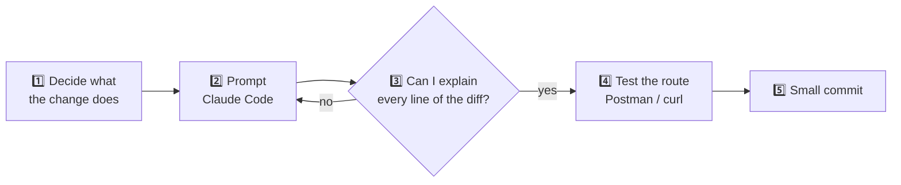

- No secrets or real personal data go into prompts.
- Commits are small and made when the work is done, never a bulk import of generated code.

---

## 8. Security and privacy

*(Mostly planned, weeks 9 and 11.)*

**Deny by default.** Every route will check:

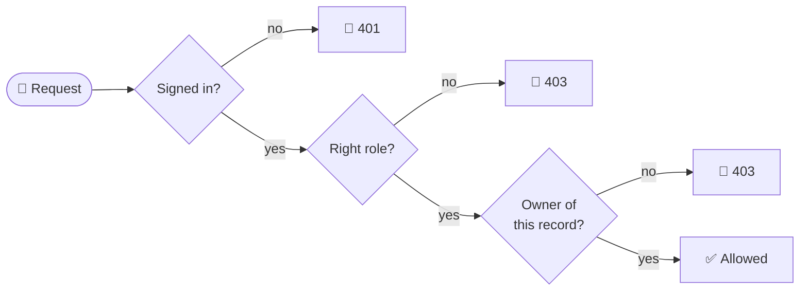

| Area | Rule |
|---|---|
| 👁️ **Per-field visibility** | Alumni choose who sees each field: only themselves, their connections, or all signed-in users |
| 🔑 **Passwords** | Hashed with argon2id; sessions in an `HttpOnly` cookie, revocable on the server |
| 📉 **Minimum data (KVKK)** | No national ID, birth date, grades or home address. Location is city level only. Reports hide groups smaller than five |
| 🧪 **No real data until week 11** | The API is open until authentication lands, so demo data is synthetic and `.env` is never committed. The database port is bound to `127.0.0.1` only |

---

## 9. Conventions

| | |
|---|---|
| 💬 **Commits** | Small and frequent, Conventional Commits with the module as scope, e.g. `feat(users): add PATCH /api/users/:id` |
| 🟢 **`main` always runs** | A week never ends with a broken `docker compose up` |
| 🧑‍💻 **Code** | Strict TypeScript, English identifiers, one folder per feature |
| 🧬 **Migrations** | Never edited once committed; `schema.prisma` and `DDD.md` change in the same commit |
| 📝 **Docs** | A commit that changes behaviour updates this README in the same commit |

---

## 10. Limitations

- The instructor's core requirements are merged into the scope as they are announced in class.
- No authentication before week 11: until then the applicant is chosen in the request body.
- No connection to the university's real student systems or single sign-on.
- A student project, not an official Istanbul University system; uses no university data.

---

## 11. Credits and license

- **UI design:** made earlier in the Web Design course with Figma Make: [AlumniTrackingSystem](https://github.com/gulnihalarikaymak/AlumniTrackingSystem), prototype at [ats.figma.site](https://ats.figma.site/).
- **Open source:** NestJS, Prisma, PostgreSQL, React, Vite, each under its own license.
- **License:** [MIT](LICENSE).

<div align="center">

---

Made with ☕ at Istanbul University · MIS

</div>
