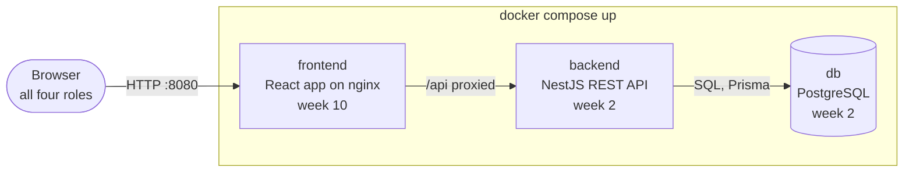
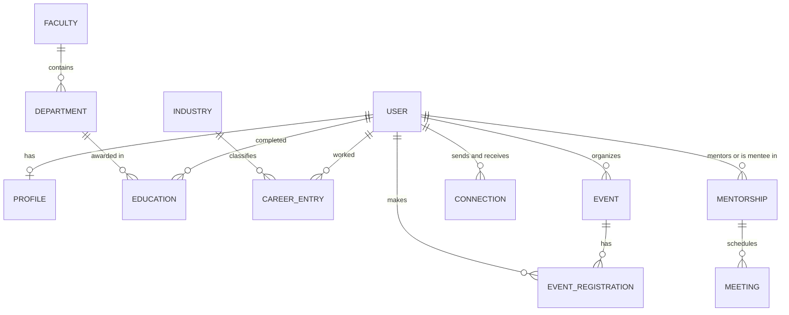
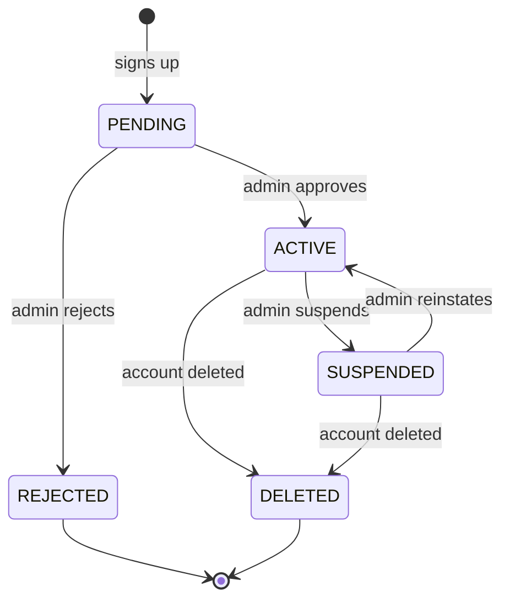
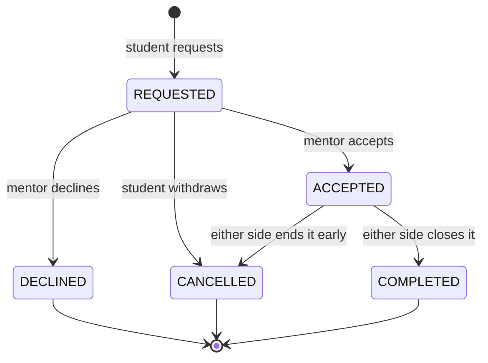

# Alumni Tracking System (ATS)

A web system that helps a university stay in touch with its graduates: who they are, where they work, and how they can help the students who come after them.

| | |
|---|---|
| **Course** | Web Programming (YBSB3001), Istanbul University, Faculty of Economics, MIS, Fall 2026 |
| **Author** | [@gulnihalarikaymak](https://github.com/gulnihalarikaymak) |
| **Back end** | TypeScript, Node.js, NestJS |
| **Database** | PostgreSQL, accessed through Prisma |
| **Front end** | React, TypeScript, Vite |
| **Run it with** | `docker compose up` |
| **AI assistant** | Claude Code |
| **Status** | 🚧 Week 1: repository, README, stack decisions |

Legend used in this document: ✅ done · 🚧 in progress · 🗓️ planned

## Contents

1. [What the system is](#1-what-the-system-is)
2. [Course contract](#2-course-contract)
3. [Quick start](#3-quick-start)
4. [Stack and decisions](#4-stack-and-decisions)
5. [Working with an AI assistant](#5-working-with-an-ai-assistant)
6. [Roadmap](#6-roadmap)
7. [Architecture](#7-architecture)
8. [Domain model](#8-domain-model)
9. [API](#9-api)
10. [Security and privacy](#10-security-and-privacy)
11. [Testing](#11-testing)
12. [Deployment and CI/CD](#12-deployment-and-cicd)
13. [Repository layout and conventions](#13-repository-layout-and-conventions)
14. [Limitations and open questions](#14-limitations-and-open-questions)
15. [Credits and license](#15-credits-and-license)

---

## 1. What the system is

Universities spend years on their students and then lose sight of them at graduation. Contact details go stale, career outcomes live in spreadsheets and chat groups, and current students who would gain from an alumnus's advice never meet one.

The Alumni Tracking System (ATS) is one place where:

- **graduates** keep their profile and career history up to date and decide who can see what;
- **students** find alumni, ask for mentorship and hear about events;
- **staff** organise events and see, in aggregate, where graduates end up;
- **administrators** decide who is let in and keep the system healthy.

ATS is a course project first: a small but complete back-end system, built in the open, one mechanism per week. It is designed so that a university could actually run it, which is why privacy and access control are in the plan from the start instead of being bolted on at the end.

### 1.1 Users and roles

| Role | Who they are | What they can do *(planned)* |
|---|---|---|
| **Student** | Currently enrolled | Search the alumni directory, request mentorship, register for events, manage their own profile |
| **Alumni** | Graduates | Keep profile and career history current, choose who sees what, offer mentorship, register for events |
| **Staff** | Academic and administrative staff | Organise events, search alumni, read aggregate reports |
| **Admin** | System administrators | Approve sign-ups, manage accounts and roles, change system settings, read the audit log |

Visitors who are not signed in see only aggregate, non-personal figures (for example, the number of alumni per country), never an individual's profile.

### 1.2 Scope

The instructor sets the core requirements every project must meet. When they are announced they are merged into this section and take precedence over my own list. The list below is what I plan on top of them, in three tiers.

| Tier | Capability | What it means | Week |
|---|---|---|---|
| **1 · Spine** | Alumni records | Create, read, update and delete a graduate's record: name, faculty and department, graduation year, current employer, city and country | 3–6 |
| 1 | Career and education history | One graduate has many career entries and many degrees | 7 |
| 1 | Directory search | Search, filter, sort and paginate alumni by name, department, graduation year, industry, city | 7 |
| 1 | Events | Create events, list them, register for them | 3–7 |
| 1 | Reference data | Faculties, departments and industries used by forms and filters | 5 |
| **2 · Multi-user** | Web interface | Sign-in, directory, events and profile screens connected to the API | 10 |
| 2 | Accounts and roles | Sign up, admin approval, sign in and out, the four roles | 11 |
| 2 | Access rules | Who may see or change what: role checks, ownership checks, per-field visibility, recorded consent | 11 |
| 2 | Mentorship | Alumni offer to mentor, students request, the mentor accepts or declines, meetings are scheduled | 12 |
| 2 | Connections | Users send, accept and decline connection requests | 12 |
| 2 | Notifications | In-app notices for approvals, requests and event changes | 12 |
| 2 | Reports | Aggregate figures for staff and admins: where graduates work, by sector, department and country | 12 |
| **3 · If time allows** | Map view | Alumni shown by city on a map | – |
| 3 | Messaging | Short messages between connected users | – |
| 3 | Bulk import and claiming | Load graduate records from a CSV file; graduates claim their record when they sign up | – |
| 3 | E-mail notifications | Sent through SMTP (a local mail catcher in development) | – |
| 3 | Data export and erasure | A user downloads or deletes their own data; an audit-log viewer for admins | – |
| 3 | Turkish and English interface | Language switch | – |

Tier 1 is what the midterm review (week 8) should be able to see running. Tier 2 is what makes ATS a real multi-user system. Tier 3 is started only when tiers 1 and 2 are solid.

**How mentors are suggested.** Suggestions are rule-based and explainable, not machine learning. A candidate mentor is scored on shared interests, same department, matching industry and free capacity, and every suggestion shows the reasons behind its score. The rules live in one service (week 12) and are covered by unit tests.

### 1.3 Not in scope

- Payments, donations or fundraising.
- A job board.
- Native mobile apps (the web interface is responsive instead).
- Integration with the university's real student information system or single sign-on. I have no access to them; identity is kept behind one module so an external provider can be added later.
- Serving several universities from one installation.

---

## 2. Course contract

| The course asks for | How this repository responds |
|---|---|
| One system in one **public** repository named exactly `alumni`, kept for all 14 weeks | This repository: `github.com/gulnihalarikaymak/alumni`. The link is submitted through Google Classroom. |
| The whole system comes up with a single command, `docker compose up` | It is the target from week 2 and covers the full stack in week 10. See [Quick start](#3-quick-start). |
| At least one commit every week, with the dates read | Small, frequent commits. Each week ends with a git tag, `week-01` to `week-14`, so any week can be checked out and run. |
| A back-end language and a database, chosen in week 1, each with a reason and one weakness | [Stack and decisions](#4-stack-and-decisions). |
| An AI assistant, with the human owning the intent, the architecture and every bug | [Working with an AI assistant](#5-working-with-an-ai-assistant). |
| A README that says what the system is and how to run it | This file. |
| A midterm graded on how far the repository has come, and a final that combines a written exam with the repository | The [Roadmap](#6-roadmap) sets a target for week 8 and a target for week 14. |

---

## 3. Quick start

> [!IMPORTANT]
> **Not runnable yet.** This repository contains only the README. The steps below are the contract the project is built towards: from week 2 they start the database and the API, and from week 10 the whole system.

**Requirements:** Git, and Docker with Compose v2 (Docker Desktop on Windows and macOS, Docker Engine plus the Compose plugin on Linux). Nothing else. You do not need Node.js, PostgreSQL or npm on your machine, and you do not need a `.env` file.

```bash
git clone https://github.com/gulnihalarikaymak/alumni.git
cd alumni
docker compose up
```

| Service | What it is | Address *(planned)* | Starts in |
|---|---|---|---|
| `db` | PostgreSQL | `localhost:5432`, reachable from your own machine only | week 2 |
| `backend` | NestJS REST API, with interactive docs | `http://localhost:3000/api/v1`, docs at `/api/docs` | week 2 |
| `frontend` | React app served by nginx, which forwards `/api` to the backend | `http://localhost:8080` | week 10 |

**Check that it worked** (from week 2):

```bash
curl http://localhost:3000/api/v1/health
```

The answer is `{"status":"ok"}`.

**Demo data.** From week 5 the database is filled with synthetic demo data on first start (no real people). From week 11 this README lists one demo account per role.

**Everyday commands**

| Task | Command |
|---|---|
| Start in the background | `docker compose up -d` |
| Follow the API logs | `docker compose logs -f backend` |
| Rebuild after code changes | `docker compose up --build` |
| Stop everything and keep the data | `docker compose down` |
| Stop everything and **delete the database** | `docker compose down -v` |
| Open a SQL prompt | `docker compose exec db psql -U alumni -d alumni` |

<details>
<summary><b>Configuration (planned)</b></summary>

Every setting has a default, so nothing here is required. To change one, copy `.env.example` to `.env` and edit it. `.env` is never committed.

| Variable | Default | Purpose |
|---|---|---|
| `POSTGRES_DB` | `alumni` | Database name |
| `POSTGRES_USER` | `alumni` | Database user |
| `POSTGRES_PASSWORD` | `alumni` | Database password. A development default: **change it on any machine other people can reach.** |
| `DB_PORT` | `5432` | Host port for PostgreSQL, bound to `127.0.0.1` only |
| `BACKEND_PORT` | `3000` | Host port for the API |
| `FRONTEND_PORT` | `8080` | Host port for the web app |
| `STUDENT_EMAIL_DOMAIN` | `ogr.iu.edu.tr` | E-mail domain accepted for automatic student verification |
| `SESSION_SECRET` | development value | Signs session cookies. The API refuses to start in production without a real one. |
| `SEED_DEMO_DATA` | `true` | Load synthetic demo data on first start |

</details>

<details>
<summary><b>Troubleshooting</b></summary>

| Symptom | Likely cause and fix |
|---|---|
| `Cannot connect to the Docker daemon`, or a pipe or socket error | Docker is not running. Start Docker Desktop and wait until it reports that it is running. |
| `port is already allocated` | Another program uses that port. Set `DB_PORT`, `BACKEND_PORT` or `FRONTEND_PORT` in `.env`. |
| The data or schema looks wrong after pulling new changes | Reset with `docker compose down -v`, then `docker compose up --build`. This deletes the local database. |
| `backend` keeps restarting | Read `docker compose logs backend`. Usually the database was not ready yet or a variable is missing. |

</details>

---

## 4. Stack and decisions

The guide asks for a reason and one weakness for the language and the database. I decided by asking four questions:

1. Can one person build **and defend** all of it in 14 weeks?
2. Does each weekly mechanism (routing, CRUD, MVC, ORM, middleware, auth, service layers) show up plainly in the code?
3. Is the stack mainstream enough for a university IT team to take over?
4. Does it start with one command?

### 4.1 Back end: TypeScript on Node.js, with NestJS

- **Why.** The front end is TypeScript too, so there is one language and one toolchain to learn. NestJS makes the weekly mechanisms explicit: controllers are the routes (week 2), controller, service and model are MVC (week 4), middleware, guards and pipes are the request pipeline (weeks 9 and 11), providers are the service layer (week 12). Strict typing also catches a class of mistakes that generated code tends to introduce.
- **Bad at.** CPU-heavy work. Node runs JavaScript on one thread, so a large report or heavy file processing blocks other requests unless it is moved to a worker or a queue.
- **Considered instead.** ASP.NET Core is an excellent fit but means a second language to defend. Django's admin site would do much of the work I am supposed to build. Express is too unstructured: I would invent and defend a new structure every week. Spring Boot is heavy for a three-hour week.

### 4.2 Database: PostgreSQL 18

- **Why.** The data is relational and rule-heavy: people, degrees, careers, events, mentorships. Foreign keys, constraints and transactions do real work here. It is free, open source, runs as a single container, and offers extras when they are needed (JSONB, full-text search, PostGIS).
- **Bad at.** Scaling writes across many servers is hard, and it needs routine housekeeping such as vacuuming and backups. At the size of a university's alumni base this is not a limit, but it is the honest weakness.
- **Considered instead.** SQL Server and Oracle are common in university IT, but they bring licence costs and heavy containers that fight the one-command rule, and Oracle has weak support in the Node ORM world. MySQL and MariaDB would work, but PostgreSQL's stricter constraints and richer types suit this data better. MongoDB would push joins and constraints into application code for data that is relational.

### 4.3 Data access: Prisma *(planned, week 5)*

- **Why.** The schema file is readable and doubles as documentation. Migrations are plain files in git, which leaves a visible weekly trail. Queries are type-safe.
- **Bad at.** Geospatial types. PostGIS columns are not first-class in Prisma and need raw SQL. City-level coordinates are plain numbers, so this does not bite yet.

### 4.4 Front end: React and TypeScript, with Vite, Tailwind CSS and shadcn/ui

- **Why.** A UI design already exists. I made it earlier in the Web Design course and exported it from Figma to React. This is a back-end course, so the time goes into the API; the UI is connected in week 10. It is a starting point, not a source of truth: the API and the data model in this document decide what the screens show.
- **Bad at.** A single-page app carries its own routing, state and data-fetching layer, and a page rendered in the browser is worse for search engines than one rendered on the server. That does not matter for a signed-in application and matters a little for the public landing page.

### 4.5 Packaging: Docker Compose

- **Why.** The course requires it, and it gives every reader the same environment.
- **Bad at.** Build time and memory. Docker Desktop on Windows and macOS runs a virtual machine, and the first `docker compose up` downloads images.

---

## 5. Working with an AI assistant

I use **Claude Code**. The assistant writes syntax; the intent, the architecture and every bug that ships are mine. In practice:

1. **Intent first.** Before prompting, I write down what a change should do and why. The assistant proposes code and I decide.
2. **I read every diff.** Code I cannot explain does not get committed. I ask for an explanation or a simpler version instead.
3. **The running system is the judge.** A route is exercised with a request or a test before I commit it.
4. **Decisions live in the repository.** When a choice is not obvious, the outcome and the reason go into `docs/decisions/` *(planned)*.
5. **No secrets or real personal data in prompts.**
6. **An honest history.** Commits are small and made when the work is done, never a bulk import of pre-generated code.

---

## 6. Roadmap

The topic column follows the course. The rest is my plan and may shift with each week's task.

| Week | Course topic | What ATS gets | Done when | Status |
|---|---|---|---|---|
| 01 | Project inception and fundamentals | Public repository, this README, stack decisions, assistant chosen | Repository is public, the README explains the system, the stack and how it will run | 🚧 |
| 02 | Routing: the doors of the system | NestJS project, one module per resource, a route map with stub handlers, a health route. **`docker compose up` starts `db` and `backend`.** | `GET /api/v1/health` answers after a clean `docker compose up`; the route map is documented | 🗓️ |
| 03 | HTTP methods and CRUD | Full CRUD for events and alumni records, held in memory: correct verbs and status codes, input validation | Every verb works; invalid input returns a clear `400` | 🗓️ |
| 04 | MVC architecture | Controller, service and model split; DTOs; conventions written down | No business logic in controllers | 🗓️ |
| 05 | Database and ORM | Prisma schema, first migration, seed script, final ER diagram | A clean `docker compose up` creates the schema and demo data | 🗓️ |
| 06 | Database integration | Events and alumni use PostgreSQL instead of memory; transactions; database errors mapped to HTTP (unique violation to `409`) | Data survives `docker compose down` followed by `up` | 🗓️ |
| 07 | Relational data and advanced routing | Education and career history (one to many), event registrations (many to many), nested routes, directory search, filter, sort and pagination | A directory query by department, year and city works and is indexed | 🗓️ |
| 08 | Midterm: code review | Repository ready for review | The [midterm target](#midterm-target-week-8) is met | 🗓️ |
| 09 | Middleware: the bouncer | Request ids, logging, security headers, CORS, rate limiting, one uniform error format, guard skeletons | Every request is logged with an id; every error has the same shape | 🗓️ |
| 10 | Views and front-end integration | The React app in `frontend/`, served by nginx, calling the API. **The full stack starts from one command.** | `docker compose up` serves the app on port 8080 | 🗓️ |
| 11 | Authentication and authorization | Sign-up with approval, sign-in and sign-out, sessions, role and ownership guards, per-field visibility, recorded consent | The permission-matrix tests pass | 🗓️ |
| 12 | Service layers | Business rules moved into services: approval workflow, mentorship and its scoring, connections, notifications, reports | Services can be tested without HTTP | 🗓️ |
| 13 | Deployment and CI/CD | GitHub Actions pipeline, production compose file, a deployed instance, backups | A push to `main` runs the tests, builds the images and deploys | 🗓️ |
| 14 | Final presentations: system handover | Handover kit: final README, architecture and decision records, runbook, demo data, known limitations | A stranger runs the system with one command using only this README | 🗓️ |

The web interface grows with the API. Week 10 connects the screens the API can already serve (directory, events, profile); mentorship, connections and reports are connected in weeks 11 and 12 as they land.

### Midterm target (week 8)

- `docker compose up` starts the database and the API from a clean clone.
- Routes are documented and follow the HTTP-method conventions.
- Alumni records and events have full CRUD on PostgreSQL through the controller, service and model layers.
- Education, career history and event registrations are modelled as relations, and the directory can be searched and paginated.
- Core routes have automated tests.
- The status table in this README is current, and every week so far has commits.

### Final target (week 14)

- Tiers 1 and 2 are complete: accounts, roles and approval, access rules, mentorship, connections, notifications, reports and the web interface.
- The system runs from one command, is deployed, and CI runs the tests on every push.
- A stranger can run and understand it using only this README and `docs/`.
- Known limitations are written down.

---

## 7. Architecture

### 7.1 The system at a glance



ATS is one deployable application with modules inside it, not a set of microservices. The browser only ever talks to the front end's address; nginx forwards `/api` to the backend, so browser and API share one origin and no cross-site requests are needed.

### 7.2 Inside the API

Every request travels the same pipeline, in this order:

```text
request → middleware → guards → pipes → controller → service → Prisma → PostgreSQL
```

| Step | Component | Question it answers | Week |
|---|---|---|---|
| 1 | Middleware | What applies to every request? Request id, logging, CORS, rate limit | 9 |
| 2 | Guards | Is the caller signed in, in the right role, and the owner of this record? | 11 |
| 3 | Pipes | Is the input valid? Validates and transforms it | 3 |
| 4 | Controller | Which route, verb and status code? Hands the work to a service | 2, 4 |
| 5 | Service | What do the business rules say? | 12 |
| 6 | Prisma | Queries and transactions against PostgreSQL | 5, 6 |

An error thrown anywhere in the pipeline is caught by one exception filter, which produces the uniform error body described in [API conventions](#91-conventions).

**Where each course mechanism lives in ATS**

| Week | Mechanism | Where it lives |
|---|---|---|
| 02 | Routing | Controllers declare the routes; the route map is documented and shown in the interactive API docs |
| 03 | HTTP methods and CRUD | Events and alumni endpoints: verbs, status codes, validation |
| 04 | MVC | Model: Prisma models and DTOs. View: the JSON the API returns and, for people, the React app. Controller: translates HTTP into service calls and nothing more |
| 05–06 | Database and ORM | `prisma/schema.prisma`, committed migrations, seed script |
| 07 | Relational data and advanced routing | Nested routes such as `/alumni/:id/career`, many-to-many event registrations, query parameters |
| 09 | Middleware | Request id, logging, security headers, CORS, rate limiting, error filter |
| 10 | Views and front-end integration | The React app and the nginx proxy |
| 11 | Authentication and authorization | Session cookie, role guard, ownership checks, visibility rules |
| 12 | Service layers | Approval workflow, mentorship rules and scoring, reports |
| 13 | Deployment and CI/CD | GitHub Actions and the production compose file |

### 7.3 Planned code layout of the back end

```
backend/
├── prisma/            schema.prisma, migrations/, seed.ts
├── src/
│   ├── main.ts        bootstrap: validation, security headers, API docs
│   ├── app.module.ts
│   ├── common/        middleware, guards, pipes, filters, decorators
│   ├── auth/          sign-up, sign-in, sessions              (week 11)
│   ├── users/         accounts, roles, approval               (week 11)
│   ├── alumni/        records, education, career history
│   ├── events/        events and registrations
│   ├── mentorship/    offers, requests, meetings, scoring     (week 12)
│   ├── connections/                                           (week 12)
│   ├── notifications/                                         (week 12)
│   ├── reports/       aggregate statistics                    (week 12)
│   └── health/
├── test/              end-to-end tests
├── Dockerfile
└── package.json
```

---

## 8. Domain model

This is a **draft**. It is finalised in week 5 and grows with each week's migrations.



Supporting tables are not drawn: `SESSION`, `CONSENT`, `NOTIFICATION`, `AUDIT_LOG` and `SETTING`, each linked to `USER` or used by it.

<details>
<summary><b>Key columns of every table (draft)</b></summary>

Names are the model names. In the database `USER` becomes `users`, because `user` is a reserved word in PostgreSQL.

| Entity | Key columns | Notes |
|---|---|---|
| `USER` | `id`, `email` (unique), `password_hash`, `role`, `status`, `created_at` | One row per person, whatever the role. Roles: `ADMIN`, `STAFF`, `ALUMNI`, `STUDENT`. Statuses: `PENDING`, `ACTIVE`, `REJECTED`, `SUSPENDED` |
| `PROFILE` | `user_id`, `first_name`, `last_name`, `headline`, `city`, `country`, `interests`, `expertise`, `open_to_mentor`, `visibility` | One to one with `USER`. `interests` and `expertise` are text arrays; `visibility` is JSON holding a level for each field |
| `FACULTY` | `id`, `name` | Reference data |
| `DEPARTMENT` | `id`, `faculty_id`, `name` | Reference data |
| `EDUCATION` | `id`, `user_id`, `department_id`, `degree_level`, `student_no`, `start_year`, `graduation_year` | `graduation_year` is empty while the person is still enrolled. `student_no` is optional and only used to match registrar records |
| `INDUSTRY` | `id`, `name` | Reference data, also used by reports and mentor scoring |
| `CAREER_ENTRY` | `id`, `user_id`, `industry_id`, `employer`, `job_title`, `city`, `country`, `start_date`, `end_date` | An empty `end_date` means the job is current |
| `EVENT` | `id`, `organizer_id`, `title`, `category`, `starts_at`, `location`, `capacity`, `status` | Categories: `CAREER`, `SOCIAL`, `CULTURAL`, `ACADEMIC`. Statuses: `DRAFT`, `PUBLISHED`, `CANCELLED` |
| `EVENT_REGISTRATION` | `event_id`, `user_id`, `registered_at` | Composite key: one registration per person per event |
| `CONNECTION` | `id`, `requester_id`, `addressee_id`, `status` | Statuses: `PENDING`, `ACCEPTED`, `DECLINED`, `CANCELLED` |
| `MENTORSHIP` | `id`, `mentor_id`, `mentee_id`, `status`, `message`, `match_score` | `match_score` runs from 0 to 100 |
| `MEETING` | `id`, `mentorship_id`, `scheduled_at`, `status` | Statuses: `SCHEDULED`, `DONE`, `CANCELLED` |
| `NOTIFICATION` | `id`, `user_id`, `kind`, `payload`, `read_at` | `payload` is JSON |
| `SESSION` | `id`, `user_id`, `expires_at`, `revoked_at` | Server-side sessions, so one can be revoked |
| `CONSENT` | `id`, `user_id`, `purpose`, `version`, `granted_at`, `revoked_at` | Records what a person agreed to and which version of the text they saw |
| `AUDIT_LOG` | `id`, `actor_id`, `action`, `entity`, `entity_id`, `created_at` | Ids only, no personal data |
| `SETTING` | `key`, `value`, `updated_by`, `updated_at` | Sign-ups open, mentoring limits, maintenance mode |

</details>

There is one `USER` table for every person in the system, whatever their role. Until week 11 it holds records without credentials (`password_hash` is empty); week 11 adds registration and sign-in on top of the same table.

### 8.1 Lifecycles

**Account.** Alumni and staff sign-ups wait for an admin. Students may be verified automatically through a university e-mail address.



**Mentorship.**



### 8.2 Business rules

1. An e-mail address is unique, ignoring case: one account per person.
2. Only `ACTIVE` accounts can sign in.
3. A graduation year cannot precede the start year, and an end date cannot precede its start date.
4. A user registers for an event once. Registration closes when the capacity is reached or the event starts, and a cancelled event accepts none.
5. A user cannot connect to themselves, and a pair has at most one open or accepted connection, in either direction.
6. A mentor must be an alumnus who is open to mentoring, and a mentee must be a student. A mentor holds at most a fixed number of active mentees (default 3, changeable by an admin), and a pair has at most one open request.
7. Deleting an account erases its personal fields and keeps only what aggregate statistics need.

---

## 9. API

### 9.1 Conventions

- **Style.** REST over HTTP, JSON in and out, every route under `/api/v1`. Field names are camelCase, timestamps are ISO 8601 in UTC, and ids are UUIDs so they cannot be guessed by counting.
- **Documentation.** The OpenAPI description is generated from the code and served as interactive docs at `/api/docs`. The web app's typed client is generated from the same description.
- **Lists.** `page` (starting at 1) and `limit` (default 20, maximum 100). A list returns `{ "data": [...], "meta": { "page": 1, "limit": 20, "total": 134 } }`.
- **Errors.** Every error has the same shape: `{ "statusCode": 404, "error": "Not Found", "message": "Event not found", "requestId": "..." }`.
- **Authentication.** A session cookie from week 11. Until then the API is open, so **development builds must never hold real data.**

### 9.2 HTTP semantics used in ATS

| Verb | Used for | Notes |
|---|---|---|
| `GET` | Reading | Safe and idempotent; never changes data |
| `POST` | Creating, and actions that are not a plain update | Returns `201` with the new resource |
| `PUT` | Replacing a resource as a whole | Idempotent; used for the mentor availability settings |
| `PATCH` | Changing some fields | Only the fields sent are changed |
| `DELETE` | Removing | Returns `204`; deleting twice ends in the same state |

| Code | Meaning in ATS |
|---|---|
| `200`, `201`, `204` | Success, created, success with no body |
| `400` | Malformed request or failed validation |
| `401` | Not signed in |
| `403` | Signed in, but not allowed |
| `404` | The resource does not exist (also used when a record must stay hidden from the caller) |
| `409` | Conflict with current state: duplicate e-mail, already registered, capacity reached |
| `429` | Too many requests |

<details>
<summary><b>Route map (draft, finalised in week 2)</b></summary>

Paths are relative to `/api/v1`. *Any* means any signed-in user, *Owner* means the person the record belongs to. Until week 11 every route is open.

**Health and public**

| Method | Path | Who | Purpose |
|---|---|---|---|
| `GET` | `/health` | Public | Liveness: the process is up |
| `GET` | `/health/ready` | Public | Readiness: also checks the database |
| `GET` | `/stats/public` | Public | Aggregate counts for the landing page, no personal data |

**Accounts**

| Method | Path | Who | Purpose |
|---|---|---|---|
| `POST` | `/auth/register` | Public | Sign up; creates an account waiting for approval |
| `POST` | `/auth/login` | Public | Sign in and receive the session cookie |
| `POST` | `/auth/logout` | Any | Sign out |
| `GET` | `/auth/me` | Any | The current account and profile |
| `GET` | `/users` | Admin | List accounts, filtered by status or role |
| `PATCH` | `/users/:id/status` | Admin | Approve, reject, suspend or reinstate |
| `PATCH` | `/users/:id/role` | Admin | Change a role |
| `DELETE` | `/users/:id` | Admin, Owner | Delete an account and erase its personal data |

**Alumni directory and records**

| Method | Path | Who | Purpose |
|---|---|---|---|
| `GET` | `/alumni` | Any | Search the directory: `q`, `department`, `graduationYear`, `industry`, `city`, `country`, `sort`, `page`, `limit` |
| `POST` | `/alumni` | Admin, Staff | Create an alumni record |
| `GET` | `/alumni/:id` | Any | One alumnus, with fields filtered by visibility |
| `PATCH` | `/alumni/:id` | Owner, Admin | Update profile fields and visibility |
| `GET` | `/alumni/:id/education` | Any | Degrees, as far as visibility allows |
| `POST` | `/alumni/:id/education` | Owner, Admin | Add a degree |
| `PATCH` | `/alumni/:id/education/:educationId` | Owner, Admin | Change a degree |
| `DELETE` | `/alumni/:id/education/:educationId` | Owner, Admin | Remove a degree |
| `GET` | `/alumni/:id/career` | Any | Career history, as far as visibility allows |
| `POST` | `/alumni/:id/career` | Owner, Admin | Add a career entry |
| `PATCH` | `/alumni/:id/career/:careerId` | Owner, Admin | Change a career entry |
| `DELETE` | `/alumni/:id/career/:careerId` | Owner, Admin | Remove a career entry |
| `GET` | `/faculties`, `/departments`, `/industries` | Any | Lookup lists for forms and filters |

**Events**

| Method | Path | Who | Purpose |
|---|---|---|---|
| `GET` | `/events` | Any | List events, filtered by `category`, `from` and `to` |
| `GET` | `/events/:id` | Any | One event |
| `POST` | `/events` | Staff, Admin | Create an event |
| `PATCH` | `/events/:id` | Staff (own), Admin | Update an event |
| `DELETE` | `/events/:id` | Staff (own), Admin | Delete or cancel an event |
| `POST` | `/events/:id/registrations` | Any | Register myself |
| `DELETE` | `/events/:id/registrations/me` | Any | Cancel my registration |
| `GET` | `/events/:id/registrations` | Staff (own), Admin | The attendee list |

**Connections**

| Method | Path | Who | Purpose |
|---|---|---|---|
| `GET` | `/connections` | Any | My connections and requests, filtered by `status` |
| `POST` | `/connections` | Any | Send a request (`addresseeId`) |
| `PATCH` | `/connections/:id` | Participants | Accept, decline or cancel |
| `DELETE` | `/connections/:id` | Participants | Remove a connection |

**Mentorship**

| Method | Path | Who | Purpose |
|---|---|---|---|
| `GET` | `/mentors` | Student | Suggested mentors, best match first, each with its reasons |
| `PUT` | `/mentors/me` | Alumni | Set my availability and areas of expertise |
| `POST` | `/mentorships` | Student | Ask a mentor |
| `GET` | `/mentorships` | Participants, Admin | List mentorships, filtered by `status` |
| `PATCH` | `/mentorships/:id` | Participants | Accept, decline, cancel or complete |
| `GET` | `/mentorships/:id/meetings` | Participants | List meetings |
| `POST` | `/mentorships/:id/meetings` | Participants | Schedule a meeting |

**Notifications, reports and administration**

| Method | Path | Who | Purpose |
|---|---|---|---|
| `GET` | `/notifications` | Any | My notifications |
| `PATCH` | `/notifications/:id` | Any | Mark one as read |
| `GET` | `/reports/employment` | Staff, Admin | Aggregates grouped by `department`, `industry` or `country` |
| `GET` | `/settings` | Admin | Read system settings |
| `PATCH` | `/settings` | Admin | Change settings: sign-ups open, mentoring limits, maintenance mode |
| `GET` | `/audit-log` | Admin | Who did what, and when |

</details>

---

## 10. Security and privacy

### 10.1 Access control *(planned, weeks 9 and 11)*

Access is **deny by default**. Every route declares who may call it, and three checks stack:

1. **Signed in?** The authentication guard.
2. **Right role?** The role guard: student, alumni, staff or admin.
3. **Right record?** The ownership check: an alumnus edits their own profile, not someone else's.

What a viewer sees is decided by the owner's visibility setting for each field: `PRIVATE` (the owner and admins), `CONNECTIONS` (accepted connections), or `COMMUNITY` (any signed-in user). Individuals are never shown to visitors who are not signed in.

Authentication uses passwords hashed with argon2id and an opaque session id in an `HttpOnly`, `SameSite=Lax` cookie (`Secure` in production), backed by a `sessions` table so a session can be revoked. Nothing is stored in `localStorage`. Sign-in and sign-up are rate limited.

### 10.2 Risks and mitigations

The table follows the OWASP API Security Top 10 (2023).

| Risk | Example in ATS | Mitigation |
|---|---|---|
| API1 Broken object-level authorization | A student edits another person's career entries through `/alumni/:id/career` | An ownership check on every route with an `:id`, and a test per role |
| API2 Broken authentication | Password guessing on sign-in | argon2id hashes, rate limiting and back-off, identical error messages for a wrong e-mail or password |
| API3 Broken object property-level authorization | `PATCH /alumni/:id` with `{"role":"ADMIN"}`, or a response that leaks an e-mail address | Whitelisted input DTOs, separate read and write shapes, responses built per viewer |
| API4 Unrestricted resource consumption | `limit=1000000`, scraping the whole directory | A maximum page size, required pagination, rate limits, query timeouts |
| API5 Broken function-level authorization | A student calls `POST /events` | Role guard on every route, deny by default, a permission-matrix test (every route against every role) |
| API6 Unrestricted access to sensitive business flows | Mass connection requests, fake sign-ups | Per-user rate limits, the approval queue, a cap on open requests |
| API8 Security misconfiguration | Verbose errors, open CORS, default passwords in production | Startup checks in production, security headers, same-origin behind the proxy, no default secrets outside development |

### 10.3 Personal data

Graduate data is personal data, which in Turkey means KVKK (Law No. 6698). The design follows a few plain principles:

- **Collect the minimum.** Not collected: national ID number, date of birth, grades, home address, precise location. Location is city level only.
- **Say why.** Every field has a stated purpose (table below).
- **The owner decides.** Visibility is set field by field. Anything beyond name, department and graduation year is opt-in, and consent is recorded with a version and a time.
- **Aggregates protect people.** Reports show counts, and groups smaller than five are suppressed so nobody can be picked out.
- **Deletion is real.** Deleting an account erases its personal fields; the audit log keeps ids only.
- **Nothing personal in logs or in git.** Demo data is synthetic and `.env` is never committed.

| Data | Purpose | Visible to |
|---|---|---|
| Name, e-mail | Identify and contact the person | Name: signed-in users. E-mail: the owner and admins, others only if the owner opts in |
| Faculty, department, degrees, graduation year | The core of an alumni record; directory filters | Signed-in users |
| Employer, job title, industry, city, country | Career tracking, mentor suggestions, reports | As the owner chooses |
| Interests, expertise, mentoring availability | Mentor suggestions | As the owner chooses |
| Password hash, sessions | Authentication | Never returned by the API |
| Event registrations | Organising events | The owner, the staff member organising the event, admins |
| Connections, mentorships, meetings | Networking and mentoring | The participants and admins |
| Consent records, audit log | Accountability | Admins |

This is design intent, not legal advice. Before real graduate data is stored anywhere, the university's data-protection officer must review the purposes, the legal basis, the retention periods and the hosting location.

---

## 11. Testing

Tests cover the rules, not the framework: permissions, state changes (approval, mentorship), scoring and constraints.

| Level | What it checks | Tools | From |
|---|---|---|---|
| Unit | Services and pure logic, such as mentor scoring and business rules | Jest | week 4 |
| API (end to end) | Real requests against a real PostgreSQL started by Docker, not a mock | Jest and Supertest | week 6 |
| Permission matrix | Every route against every role returns the expected `2xx`, `401` or `403` | Table-driven end-to-end tests | week 11 |
| Interface smoke test | Sign in, search the directory, register for an event | Playwright | week 10 or later, optional |
| Continuous integration | Lint, tests and build on every push | GitHub Actions | week 13 |

---

## 12. Deployment and CI/CD

*(planned, week 13)*

- **Pipeline.** On every push GitHub Actions installs, lints, tests and builds. On `main` it also builds the Docker images and publishes them to the GitHub Container Registry.
- **Production compose file.** No database port is published, secrets come from the environment, nginx serves the web app and forwards `/api`, and TLS ends at a reverse proxy in front.
- **Migrations.** Applied automatically on deploy with `prisma migrate deploy`, and never edited once committed.
- **Backups.** A nightly `pg_dump`, plus a restore rehearsal, because an untested backup is only a hope.
- **Observability.** `/health` and `/health/ready`, structured JSON logs, no personal data in logs.
- **Hosting.** A single Linux virtual machine running the same compose file. The provider is not chosen yet; the setup has no provider-specific parts.

---

## 13. Repository layout and conventions

```
alumni/
├── README.md               this file
├── docker-compose.yml      the whole system, one command            (week 2)
├── .env.example            configuration defaults                   (week 2)
├── backend/                NestJS API and Prisma                    (week 2)
├── frontend/               React app                                (week 10)
├── docs/
│   └── decisions/          short records of why a choice was made
└── .github/workflows/      CI/CD                                    (week 13)
```

**Conventions**

- **Commits.** Small and frequent, in the Conventional Commits style with the module as scope, for example `feat(events): add PATCH /events/:id`. Each week ends with an annotated tag, `week-01` to `week-14`.
- **`main` always runs.** A week is never left ending with a broken `docker compose up`. Short-lived branches are fine.
- **Code.** Strict TypeScript, ESLint and Prettier, English identifiers and comments, one module per feature.
- **Database.** Migrations are append-only; a committed migration is never edited. Seed data is synthetic.
- **Configuration.** Only through environment variables. `.env` is never committed.
- **Documentation.** A commit that changes behaviour updates this README in the same commit. The roadmap's status column is the single source of truth for what works.

---

## 14. Limitations and open questions

1. **The instructor's core requirements** are not reflected yet. They will be merged into [Scope](#12-scope) and take precedence over my list.
2. **No authentication before week 11.** Development builds must not hold real data.
3. **No connection to university systems.** ATS does not talk to the real student information system or single sign-on. Identity sits behind one module so that can change later.
4. **Where the first alumni records come from** is open. Options are a registrar export loaded by CSV (tier 3), or self-registration with admin approval. The course version starts with self-registration and seed data.
5. **KVKK review** by the university's data-protection officer is needed before any real use (see [Personal data](#103-personal-data)).
6. **Ownership after the course.** Who would host and maintain ATS if a university adopted it is undecided.
7. **Mentor scoring is heuristic.** Its weights need feedback from real use.
8. **Not an official system.** ATS is a student project. It is not an official Istanbul University system and uses no university data.

---

## 15. Credits and license

- **UI design.** Made earlier in the Web Design course with Figma Make: [github.com/gulnihalarikaymak/AlumniTrackingSystem](https://github.com/gulnihalarikaymak/AlumniTrackingSystem), with a live prototype at [ats.figma.site](https://ats.figma.site/). Only its basic ideas feed this document; the API and the data model here are the source of truth.
- **Open-source components.** NestJS, Prisma, PostgreSQL, React, Vite, Tailwind CSS and [shadcn/ui](https://ui.shadcn.com/) (MIT), each under its own license.
- **License.** Not chosen yet. Until one is added, all rights are reserved.
